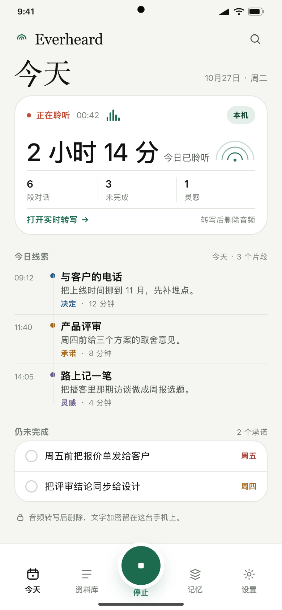
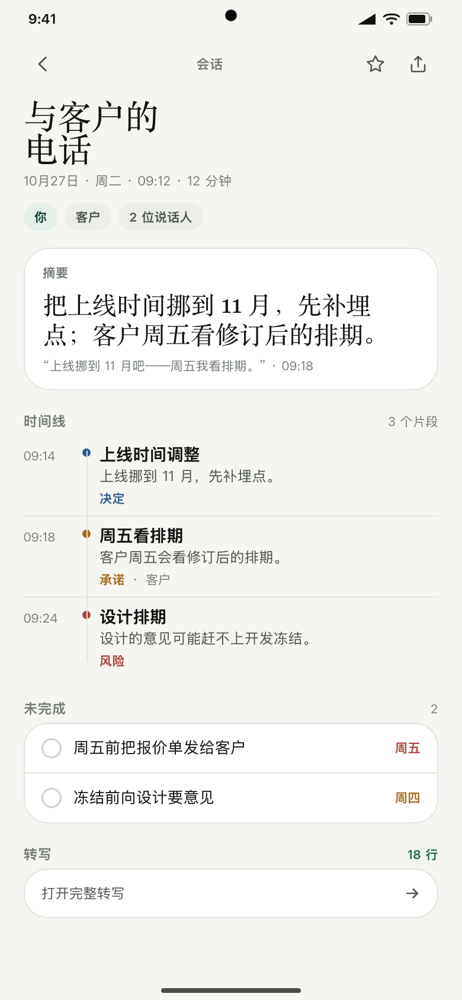

# Everheard

[](https://github.com/markyu0401/everheard-android/actions/workflows/ci.yml)

[English](README.md) | **简体中文**

一个 Android 端的「全天候对话记忆」应用：记录你参与的对话，在手机上转写成文字，区分说话人，把说过的话变成承诺、项目时间线和每周复盘——但不保留原始录音。

> **状态：pre-alpha。** 调试构建可用（Compose 外壳、四标签底部任务栏 + 中央采集 orb、内嵌 Instrument Sans / Instrument Serif / Noto Serif SC 字体系统，支持应用内语言与主题设置、带时段/电量/温度/静音门控的全天候采集核心、排除应用播放守卫和可见的麦克风占用状态、端侧 VAD/ASR/说话人 spike、加密转写存储、实时草稿与搜索、带手动标记和语义要点的今日时间线、单条分享/删除/导出、全部清空、带语言下拉的声音档案和“我”片段标注、本地与可选 LLM 摘要/承诺/事件的加密记忆层、关键词项目时间线、确定性周洞察、基于明确说话人标签的人物页、自带模型服务设置，以及本机只读 MCP 服务）；**pre-alpha APK：[Releases](https://github.com/markyu0401/everheard-android/releases)。**开发计划见 [docs/PLAN.md](docs/PLAN.md)，架构见 [docs/DESIGN.md](docs/DESIGN.md)，新版视觉方向见 [docs/DESIGN-V2.md](docs/DESIGN-V2.md)，功能对齐与优先级见 [docs/BACKLOG.md](docs/BACKLOG.md)。
## 界面

<p align="center">
  
  
</p>

演示数据 / 界面预览。应用界面提供英文与简体中文。

## 为什么再做一次

参考产品（OPPO AI 心力球）验证了形态：一个常驻采集设备 + 一个把对话变成记忆的 App。它自己的用户已经指出了弱点：

- 旁人的对话会被记成「我」的进展。
- 临时的小承诺（「周三三点回个电话」）不按按钮就漏。
- 数据锁在云账号里，按录制时长计费。
- 只支持一个手机品牌。

Everheard 是纯手机、开源的答案：本地优先的文字、可纠正的归属、自选的模型、没有订阅。

## v1 目标

- **24 小时待命采集**，支持允许/排除时段（睡觉、上课、不想录的会议）。
- **端侧 ASR**（sherpa-onnx）：流式实时草稿 + SenseVoice 最终转写，可选云端二次解码。
- **说话人归属**：自己录一次声纹；其他人自动聚类；滑一下「不是我的事」教它过滤。
- **承诺抽取**：带原句证据，一键进系统日历。
- **项目时间线**：同一主题的多场对话自动归集，每周复盘带证据。
- **自带模型**：任何 OpenAI 兼容端点（LiteLLM、DeepSeek、OpenAI、Ollama、本地 llama.cpp）。
- **MCP server**：把记忆暴露给 Claude、Cursor 或任何 MCP 客户端。
- **默认只留文字**：转写完删除音频；文字用 AES-256-GCM 加密，密钥在 Android Keystore。

## v1 不做

- 不做硬件、不做 BLE、不做可穿戴。
- 不做账号系统、不做多端同步、不做遥测。
- 不做 iOS、不上架 Play、不做订阅。
- 不做隐蔽录音：通知栏和实时页始终可见。

## 架构一览

```
AudioRecord（16 kHz 单声道 PCM16）
  → 60 秒环形缓冲
  → Silero VAD → 5–30 秒片段（200 ms 重叠）
  → 端侧 ASR（流式草稿 + SenseVoice 最终转写）→ 可选云端二次解码
  → 声纹 embedding + 在线聚类 → 「我」/ A / B / 背景
  → KeystoreCipher（AES-256-GCM）：一个加密 JSON 文档，存 session、segment、utterance、commitment、project、insight
  → LLM（JSON schema）：摘要、承诺、周复盘
  → Compose UI：今日、实时录制、会话详情、项目、觉察、人物、设置
  → MCP server（HTTP + token）：search_memory、list_commitments、get_project
```

采集服务是一个常驻的 `microphone` 前台服务；时段规则只门控 `AudioRecord`，不 stop/start 服务——因为 Android 不允许在后台新建麦克风前台服务。

## 安装

从 [Releases](https://github.com/markyu0401/everheard-android/releases) 下载 `everheard-0.1.0-alpha.apk`。需要 Android 8.0+（minSdk 26）。端上模型已内置，下载约 360 MB。如果之前装过 debug 构建，请先卸载：release 用的是另一把签名密钥，数据不会保留。

## 构建

需要 JDK 21、Android SDK platform 37 和 Gradle wrapper（AGP 9.4.1、Gradle 9.8.2、内置 Kotlin）。

```bash
export JAVA_HOME=/opt/homebrew/opt/openjdk@21   # macOS Homebrew
./gradlew lint testDebugUnitTest assembleDebug
# 调试 APK：app/build/outputs/apk/debug/app-debug.apk
```

模型不进仓库，用脚本下载并校验 SHA-256：

```bash
scripts/fetch_models.sh   # 流式 ASR（约 437 MB 压缩包）+ SenseVoice（228 MB）+ 声纹模型（27 MB）
```

Silero VAD（629 KB，MIT）已提交，保证首次启动不依赖下载。流式 ASR、SenseVoice 和声纹模型位于 `app/src/main/assets/models/`，已被 gitignore。

仪器测试（服务、AudioRecord、VAD、ASR、声纹）在真机或模拟器上运行：

```bash
export ANDROID_HOME="$HOME/Library/Android/sdk"
sdkmanager "emulator" "system-images;android-36;aosp_atd;arm64-v8a"
avdmanager create avd -n everheard_atd -k "system-images;android-36;aosp_atd;arm64-v8a" --device pixel_7
emulator -avd everheard_atd -no-window -no-audio -no-boot-anim -gpu swiftshader_indirect &
./gradlew connectedDebugAndroidTest
```

## 文档

- [开发计划](docs/PLAN.md)
- [架构与设计](docs/DESIGN.md)
- [M0 spike 计划](docs/plans/2026-10-26-m0-spikes.md)
- [国产 ROM 兼容矩阵](docs/ROM-MATRIX.md)
- [法律说明](docs/LEGAL.md)
- [隐私](docs/PRIVACY.md)
- [第三方声明](THIRD_PARTY_NOTICES.md)

## 法律

录音是否合法取决于所在地和在场的人。Everheard 默认显式、可见地采集，并提供会议模式提示音；它不是隐蔽录音器。它是这个品类的独立实现：没有使用 OPPO 的代码、模型、素材或界面文件，与 OPPO 也没有隶属、背书或赞助关系。在他人周围使用前请读 [docs/LEGAL.md](docs/LEGAL.md)。

## 许可证

代码：Apache-2.0。模型和第三方二进制保留各自许可证，见 [THIRD_PARTY_NOTICES.md](THIRD_PARTY_NOTICES.md)。「Everheard」是工作名，v1.0 前可能更换。
